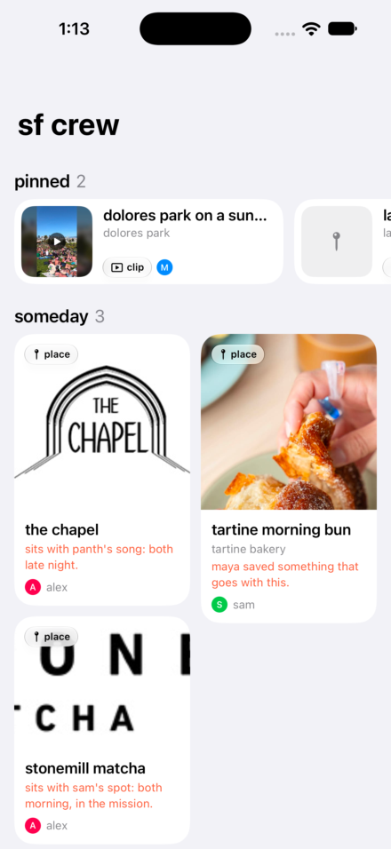
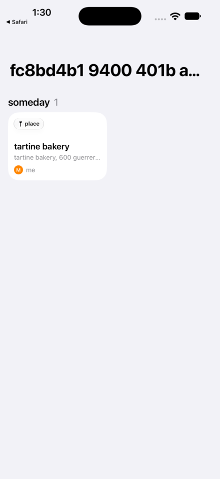
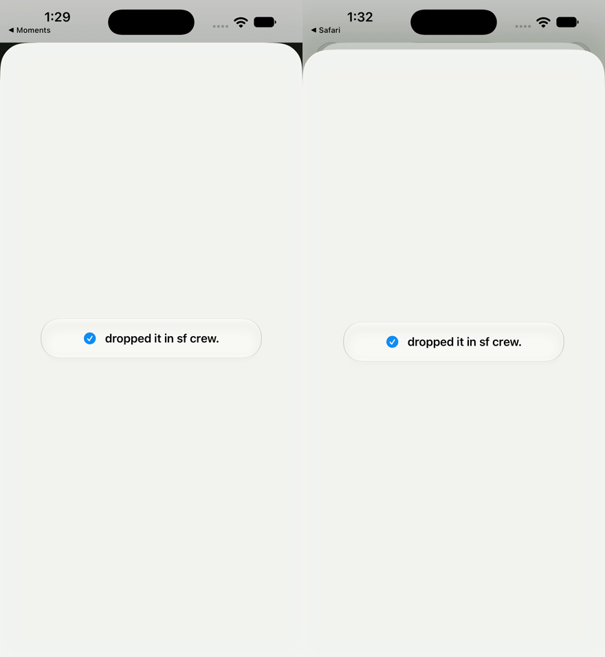
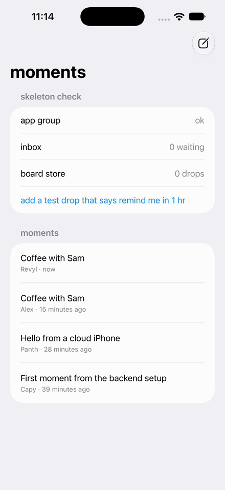

# Revyl run evidence

## Share, drop and join on main at 70f40e0

| | |
| --- | --- |
| Build | `revyl build --platform ios`, build version `d84e4a12-fbbd-418e-8156-76d6c0c5559d`, from main at 70f40e0 (sync, invite join, share into the current board, board tidy, sf crew reseed). 1m42s with a warm cache |
| Device | iPhone 17 Pro Max, iOS 27.0, a fresh simulator per run |

| Test | Run | Result |
| --- | --- | --- |
| `views-4-join-by-code` | [7d900156](https://app.revyl.ai/tests/report?taskId=7d900156-2241-414c-9a4e-496ead468a7d) | Passed in 78 s. The board was empty, the invite link opened "join a board" with SFCREW filled in, the agent typed "revyl" and tapped join, and the title became sf crew with drops by alex, sam and maya. |
| `phase1-2-drop-lands-on-board` | [3f5c864d](https://app.revyl.ai/tests/report?taskId=3f5c864d-9145-4fb3-b6b7-9e4d0e901634) | Passed in 211 s. The board was empty, the agent shared Tartine Bakery from Safari to Moments, and the app showed it right away and 20 s later as "tartine bakery" with a place pill under someday. |
| `phase1-1-share-into-board` | [925f985e](https://app.revyl.ai/tests/report?taskId=925f985e-58cc-4a2d-a9d9-1c53e661a1f3) | Failed on both note checks. The join and both shares worked, and the video shows "dropped it in sf crew." after the Safari share and after the Photos share, but the note closes after 2 s and each check looked at the screen about a minute later. |

Runs that don't count:

- [8cb02103](https://app.revyl.ai/tests/report?taskId=8cb02103-3569-4fef-a250-833dbe9b67f1), `phase1-2` v1: reported a pass, but the shared link was a bare Google map at @45.46,-119.57 saved as "google maps". The `/maps/place/` URL lost the place, and the check accepted the wrong item. v2 shares the `?q=` URL and requires the title Tartine Bakery.
- [fe9eb079](https://app.revyl.ai/tests/report?taskId=fe9eb079-917c-4788-9481-46a92bf9507b), `phase1-1` v1: same note timing failure. It used `appdemo://seed`, which makes the device the seed person panth while online, so v2 joins as a fresh person instead.

## add-moment-coffee-with-sam on the iOS skeleton

| | |
| --- | --- |
| Build | `revyl build --platform ios` with `.revyl/config.yaml`, build version `a9eee349-cd68-4743-a325-d8c3e1ff9ef0`, from main plus `capy/ios-skeleton` at 1c06721 |
| Device | iPhone 17 Pro Max, iOS 27.0 |
| Run | [3c40d653](https://app.revyl.ai/tests/report?taskId=3c40d653-2478-4efc-add6-d79a52aa32d3), passed both steps in 64.8 s |
| What the agent did | Tapped the pencil, typed "Revyl" as the name and "Coffee with Sam" as the moment, and tapped post |
| What it checked | The top row reads "Coffee with Sam", "Revyl · now" |

## Earlier runs

- [445753a4](https://app.revyl.ai/tests/report?taskId=445753a4-d6d2-40e2-b4cb-be24144d0de7), PR #2's moments app, build `d0ac52d6`: passed after a real tap, type and post (130 s).
- [ed390d64](https://app.revyl.ai/tests/report?taskId=ed390d64-d4ab-4800-b00d-4b15a6571b0c), skeleton build: reported a pass but performed no actions. The "Coffee with Sam" row from the first run was still in the shared Convex list, so the agent treated the add step as done. This run doesn't count. After it, the test was rewritten to require a new row by "Revyl" posted just now.
